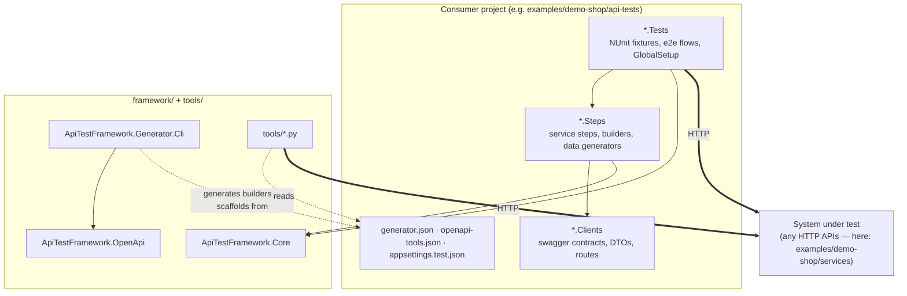
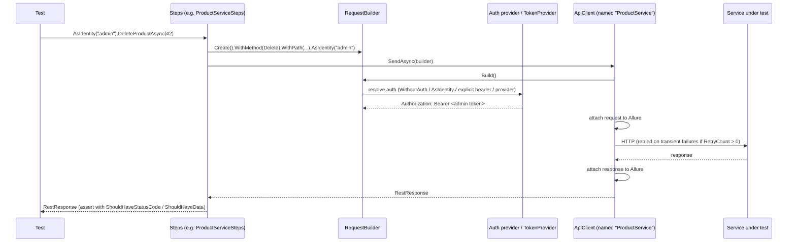
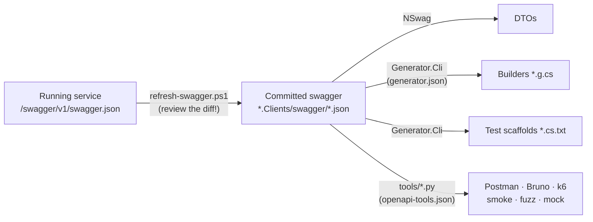

# Architecture

This repository contains a **product-agnostic API test framework** and, separately, an
**example product** that shows how to use it. Keeping the two apart is the most important
design rule: the framework must be reusable for any set of HTTP APIs without editing its code.

## Repository layout

```
framework/                         ← reusable, knows no concrete service
├── src/
│   ├── ApiTestFramework.Core          HTTP client, request builder, auth, DI, config,
│   │                                  assertions, Allure logging, BaseTest lifecycle
│   ├── ApiTestFramework.OpenApi       OpenAPI loader, schema extractor, builder & test scaffolders
│   └── ApiTestFramework.Generator.Cli console front-end for the generators (generator.json)
└── tests/
    └── ApiTestFramework.Framework.Tests   offline unit tests of the framework itself
tools/                             ← reusable Python tooling driven by openapi-tools.json
scripts/ci/                        ← reusable CI helpers (TRX → Markdown summary)
examples/demo-shop/                ← the example: system under test + its API tests
├── services/                          Auth/Product/Order services (example only)
└── api-tests/                         DemoShop.Clients / .Steps / .Tests + configs
docs/                              ← this documentation
```

## Layers and the dependency rule



| Rule | Why |
|------|-----|
| `framework/` never references a consumer project, a service name, a route or a port | The same binaries serve any product |
| Everything product-specific is **configuration** (`appsettings.test.json`, `generator.json`, `openapi-tools.json`) or **consumer code** (`*.Clients`, `*.Steps`, `*.Tests`) | Adopting = writing config + consumer code, never forking the framework |
| Tests never talk HTTP directly — they call **steps** | One place per endpoint to change when the API changes; steps are reused by API and e2e tests alike |
| Services under test do not reference the tests or the framework | The system under test stays a black box reachable over HTTP |

## The three layers of a consumer project

| Layer | Contains | Written by |
|-------|----------|-----------|
| **Clients** | Offline swagger files (the contract), DTOs (NSwag or hand-written), route constants | Generated / copied from the API |
| **Steps** | One step class per service (`[AllureStep]` methods wrapping requests), fluent test-data builders (`*.g.cs` generated + `Custom/*.cs` partials), data generators | Builders generated, steps hand-written |
| **Tests** | NUnit fixtures inheriting `BaseTest`, `GlobalSetup` (container, identities), end-to-end flows, generated scaffolds (`*.cs.txt`) to promote | Hand-written, scaffolds generated |

## What happens when a test sends a request



Details: [Core reference](framework/core.md), [Authentication](framework/authentication.md).

## Where generated code comes from



The **committed swagger file is the contract**. It is curated (required fields, documented
401/403 responses, nullability) and usually more precise than what a framework like
Swashbuckle emits at runtime. CI fails when generated files no longer match it
([CI](ci.md)).

## Technology

| Concern | Choice |
|---------|--------|
| Runtime | .NET 8 |
| Test runner | NUnit 4 |
| HTTP | RestSharp 112 |
| DI | Autofac |
| Assertions | FluentAssertions 7 (Apache 2.0 — 8.x is commercial) |
| Test data | Bogus + generated fluent builders |
| Reporting | Allure (Allure.NUnit) + Serilog console logs |
| OpenAPI parsing | Microsoft.OpenApi.Readers |
| Tooling | Python 3 (stdlib only, schemathesis optional), k6 |
| CI | GitHub Actions, Jenkins |
